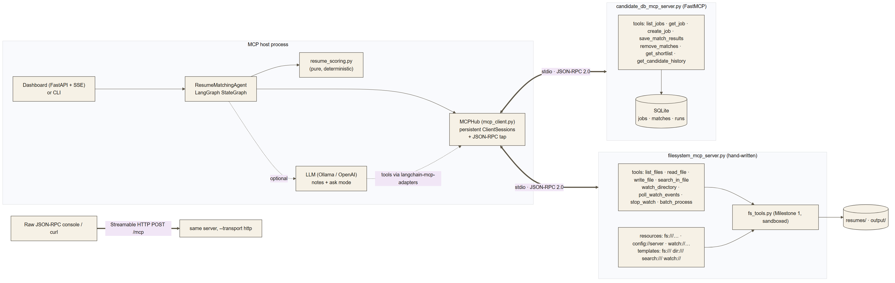
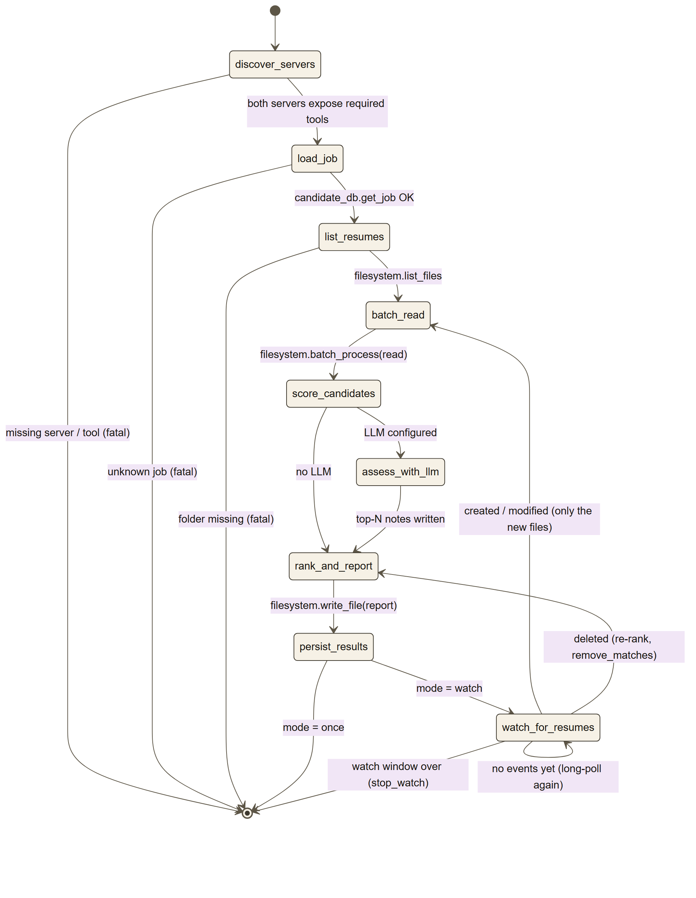

# MCP Resume Matcher

**Milestone 2: the Milestone 1 file-system tools as a Model Context Protocol server, and a LangGraph resume-matching agent that reaches files and data only through MCP.**

[](https://github.com/namanmanocha19/mcp-resume-matcher/actions/workflows/tests.yml)

| Deliverable | Where |
|---|---|
| MCP filesystem server (JSON-RPC 2.0, resource discovery, config management) | [`filesystem_mcp_server.py`](filesystem_mcp_server.py) |
| `watch_directory()` and `batch_process()` | same file: `DirectoryWatcher`, `_tool_watch_directory`, `_tool_batch_process` |
| Refactored LangGraph agent with an MCP client | [`matching_agent.py`](matching_agent.py) + [`mcp_client.py`](mcp_client.py) |
| Multi-MCP bonus (a second server: SQLite job/candidate database) | [`candidate_db_mcp_server.py`](candidate_db_mcp_server.py) |
| State machine / workflow diagrams of agent ↔ MCP interaction | [`docs/ARCHITECTURE.md`](docs/ARCHITECTURE.md), [`docs/diagrams/`](docs/diagrams) |
| Test scenarios | [`docs/TEST_SCENARIOS.md`](docs/TEST_SCENARIOS.md), [`tests/`](tests) (99 tests) |
| Live dashboard used in the demo video | [`dashboard/`](dashboard) |
| Demo video source (Remotion) | [`video/`](video) |



---

## Quick start

Requires Python 3.10+.

```bash
python -m venv .venv
.venv\Scripts\activate          # macOS/Linux: source .venv/bin/activate
pip install -r requirements.txt

python matching_agent.py --list-jobs
python matching_agent.py --job senior-python-backend -v
```

```
> discover_servers   done in 12 ms -- filesystem: 8 tools / 9 resources, candidate_db: 7 tools / 1 resources
> load_job           -> candidate_db.get_job({"job_id": "senior-python-backend"})
> list_resumes       -> filesystem.list_files({"directory": "resumes"})
> batch_read         -> filesystem.batch_process({"operation": "read", "filepaths": [...8 files]})
                      done in 327 ms -- 8/8 read with 8 workers in 325.2 ms
> score_candidates   done in 5 ms -- scored 8; best John Doe (95.7)
> rank_and_report    -> filesystem.write_file({"filepath": "output/match_senior-python-backend.md", ...})
> persist_results    -> candidate_db.save_match_results(...)

 #  Candidate          Score  Tier             Missing
 1  John Doe            95.7  Strong match     -
 2  Sara Lindqvist      67.0  Potential match  PostgreSQL
 ...
 7  Alex Chen           24.5  Not a fit        FastAPI, PostgreSQL, Docker, AWS, Python(weak)
```

The live dashboard:

```bash
python -m dashboard.app        # http://127.0.0.1:8000
```

More agent modes:

```bash
python matching_agent.py --job senior-python-backend --watch --watch-seconds 120   # then drop a resume into resumes/
python matching_agent.py --job ml-engineer-nlp --llm ollama                         # + LLM notes on the top 3
python matching_agent.py --ask "Who should we interview for platform-sre?" --llm ollama
python matching_agent.py --job-text "React + TypeScript dev with Jest testing"
python matching_agent.py --diagram                                                  # Mermaid of the compiled graph
```

The LLM is optional: rankings are deterministic and work with no model. To use one, copy `.env.example` to `.env` and set `LLM_PROVIDER` to `ollama`, `openai` or `openrouter`. With Ollama, any tool-capable model works (`OLLAMA_MODEL`). The demo used `ornith-1.5:9b`.

---

## Part A: `filesystem_mcp_server.py`

The server is written **from scratch on the server side** (no MCP SDK; `tests/test_architecture.py` enforces this), so every protocol detail lives in one readable file. It is still a standard MCP server: the official Python SDK client talks to it over both transports (`tests/test_sdk_interop.py`), and Claude Desktop or MCP Inspector can launch it (see [`claude_desktop_config.example.json`](claude_desktop_config.example.json)).

### Protocol

| Area | Implementation |
|---|---|
| Framing | JSON-RPC 2.0: requests, notifications (never answered), responses, **batches**, `id` echoed (string, int or null) |
| Lifecycle | `initialize` with version negotiation (`2025-11-25`, `2025-06-18`, `2025-03-26`, `2024-11-05`), `notifications/initialized`, `ping`, `notifications/cancelled` |
| Discovery | `tools/list`, `resources/list`, `resources/templates/list`, `prompts/list` (all **cursor-paginated**); `config://server`; HTTP `GET /` and `/healthz` |
| Version awareness | `structuredContent`, tool `title` and resource `_meta` only for clients that negotiated `2025-06-18`+; `annotations` from `2025-03-26` |
| Server pushes | `notifications/resources/list_changed`, `notifications/resources/updated` (subscriptions), `notifications/progress`, `notifications/message` (`logging/setLevel` honoured) |
| Transports | **stdio** (newline-delimited, requests run on a worker pool so a long `batch_process` never blocks `ping`) and **Streamable HTTP** (`POST /mcp`, `Mcp-Session-Id`, `MCP-Protocol-Version` check, Origin check against DNS rebinding, `DELETE` ends the session) |
| Safety | All paths sandboxed to `root` (Milestone 1 `fs_tools`), JSON-Schema validation of every argument, batch and payload limits, optional read-only mode |

### Error handling

| Code | When | Example |
|---|---|---|
| `-32700` Parse error | invalid JSON | `{"jsonrpc": "2.0", "id": 6, "method": "ping"` |
| `-32600` Invalid Request | not a JSON-RPC 2.0 object, bad `id` type, empty batch | `{"jsonrpc": "1.0", ...}` |
| `-32601` Method not found | unknown method | `tools/delete_everything` |
| `-32602` Invalid params | unknown tool, params not an object, bad cursor, bad prompt args | `tools/call {"name": "format_disk"}` |
| `-32603` Internal error | unexpected exception (logged; no internals leaked; connection stays up) | |
| `-32000` Server not initialized | any request except `ping` before `initialize` | |
| `-32002` Resource not found | `resources/read` on a missing or sandbox-escaping URI | `fs:///resumes/ghost.pdf` |
| `-32004` Request too large | batch over the configured limit | |
| `isError: true` result | **tool execution** failures: bad arguments, sandbox violation, missing file. Per the 2025-11-25 spec these are results, not protocol errors, so the model can read them and retry | `read_file {"filepath": "../../secrets.txt"}` → `outside_sandbox` |

A real raw session, piped straight into the server's stdin: [`demo/raw_stdio_session.jsonl`](demo/raw_stdio_session.jsonl) → [`demo/raw_stdio_output.jsonl`](demo/raw_stdio_output.jsonl). The responses come back **out of order** (id 1, id 3, the parse error with `id: null`, ids 4 and 5, then id 2 after its progress notifications), because requests run concurrently. JSON-RPC allows this.

### Tools

| Tool | Milestone | Notes |
|---|---|---|
| `list_files(directory, extension?)` | 1 | read-only |
| `read_file(filepath, max_chars?)` | 1 | PDF / DOCX / TXT text + metadata; capped by `max_read_chars` |
| `write_file(filepath, content, overwrite?)` | 1 | atomic; text formats only; hidden when `allow_write=false` |
| `search_in_file(filepath, keyword, ...)` | 1 | literal, case-insensitive, with context |
| **`watch_directory(directory, extensions?, poll_interval_seconds?)`** | new | Starts a background watcher and returns `watch_id` plus a subscribable `watch://` URI. Idempotent. |
| `poll_watch_events(watch_id, since_seq?, timeout_seconds?)` | new | **long-poll** cursor over created / modified / deleted events; works on every transport |
| `stop_watch(watch_id)` | new | |
| **`batch_process(operation, filepaths? \| directory?, keyword?, ...)`** | new | `read` / `search` / `metadata` over many files in **one call**, on a thread pool; per-file success or failure, input order preserved, summary stats, `notifications/progress` when given a `progressToken` |

**watch_directory design.** The watcher polls `os.stat` instead of using OS file events, so it behaves the same on Windows, Linux, macOS, network shares and OneDrive. A file is reported only once its size and mtime are unchanged for one full interval ("settled"), so the agent never reads a resume that is still being copied. One Windows detail: `DirEntry.stat()` is cached from the directory listing and misses a file that is still growing; a test caught this. Events reach the client three ways: `poll_watch_events` (pull), `resources/list_changed` (the new file is now a resource), and `resources/updated` on the subscribed `watch://` URI.

### Resources

The brief asks for the Milestone 1 tools to be exposed **as MCP resources** too:

| Resource | Equivalent tool |
|---|---|
| `fs:///resumes/resume_john_doe.pdf` (one per resume, listed by `resources/list`) and template `fs:///{+path}` | `read_file` |
| template `dir:///{+path}{?extension}` | `list_files` |
| template `search:///{+path}{?keyword,whole_word}` | `search_in_file` |
| `watch://{watch_id}` (subscribable) | `poll_watch_events` |
| `config://server`: effective config, the **source of every value**, stats, active watches | none |

`write_file` stays a tool only, because resources are read-only by design.

### Configuration management

Precedence: **defaults < JSON file (`--config` / `MCP_FS_CONFIG`) < `MCP_FS_*` environment variables < CLI flags.** Values are validated, unknown keys are rejected, and `config://server` reports where each value came from.

```bash
python filesystem_mcp_server.py --print-config
python filesystem_mcp_server.py --config mcp_server_config.example.json --read-only
MCP_FS_BATCH_MAX_WORKERS=4 python filesystem_mcp_server.py --transport http --port 8765
docker build -t filesystem-mcp . && docker run -p 8765:8765 filesystem-mcp
```

Keys: `root`, `resource_dirs`, `max_read_chars`, `allow_write`, `batch_max_files`, `batch_max_workers`, `watch_poll_interval`, `watch_max_watchers`, `page_size`, `log_level`, `traffic_log` (JSONL tap of every message), `transport`, `host`, `port`.

---

## Part B: `matching_agent.py`

| Milestone 1 agent | This agent |
|---|---|
| `import fs_tools`, calls functions in-process | **no file-system or database imports at all** (`tests/test_architecture.py` checks the AST) |
| hand-rolled tool loop | LangGraph `StateGraph` with conditional edges |
| one file at a time | one `batch_process` round trip for all resumes |
| no awareness of new files | `watch_directory` loop: incremental scoring of new resumes, re-rank on deletes |
| one data source | two MCP servers through one client hub |

### Workflow



* `discover_servers` lists what each server offers and fails fast if a required tool is missing.
* Scores come from [`resume_scoring.py`](resume_scoring.py) (pure functions): 60 × required-skill coverage + 20 × nice-to-have + 15 × experience fit + 5 × depth. A skill mentioned only with a weak qualifier ("basic Python", "introductory course", "Docker (basic)") gets partial credit, which is why Alex Chen and Emily Watson rank last for the Python role despite mentioning Python.
* The LLM (optional) only writes two-sentence notes for the top N. It never changes a score, and an LLM outage is recorded as a warning, not a crash.
* In watch mode, only new or changed files are re-read. Deleted resumes leave the ranking and the database (`remove_matches`).

### The MCP client (`mcp_client.py`)

`MCPHub` keeps **one persistent `ClientSession` per server** (official SDK). `langchain_mcp_adapters.MultiServerMCPClient` opens a fresh session, and a fresh stdio subprocess, per tool call by default, which would throw away a running `watch_directory`. The hub also:

* taps the raw JSON-RPC streams (`on_traffic`) and forwards server notifications (`on_notification`); the dashboard is built on these,
* turns `isError` results into `MCPToolError` and prefers `structuredContent`,
* hands LangChain tools to an LLM with `langchain_tools()` (via `langchain-mcp-adapters` on the *open* sessions).

### Multi-MCP (bonus)

`candidate_db_mcp_server.py` is built with the official SDK's **FastMCP**, the opposite approach to the hand-written filesystem server, and the same client talks to both. It stores job postings (4 seeded roles) and match history in SQLite:
tools `list_jobs`, `get_job`, `create_job`, `save_match_results`, `remove_matches`, `get_shortlist`, `get_candidate_history`; resources `db://jobs`, `db://jobs/{job_id}`, `db://jobs/{job_id}/shortlist`; prompt `compare_candidates`.

In `--ask` mode the LLM gets the tools of **both** servers and picks between them. In the demo it answered "top 3 for senior-python-backend and what they're missing" by calling `list_jobs` and then `get_shortlist` on the database server.

---

## Dashboard

`python -m dashboard.app` starts an MCP host that streams everything to the browser over SSE:

* **Discovered capabilities**, live from `tools/list` / `resources/list` / templates / prompts. It re-lists resources when the server pushes `list_changed`.
* **The LangGraph state machine**, with the active node and the edge just taken lit up, plus per-node timings.
* **The ranking**, which reorders with an animation as new resumes are scored. LLM notes appear inline.
* **JSON-RPC traffic** for both servers: requests, responses with latency, errors, notifications. Click a row to see the message.
* **Raw console**: hand-craft requests against the same server's **HTTP** transport (presets for each error code).
* **Ask the agent**: the LLM with tools from both servers.

---

## Tests

```bash
pytest          # 99 tests, ~1 min, no network or API key needed
```

See [`docs/TEST_SCENARIOS.md`](docs/TEST_SCENARIOS.md) for the scenario list. Highlights: JSON-RPC edge cases (batches, null ids, bad ids, notifications never answered), every error code, version negotiation, pagination, watch events including the half-written-file case, progress notifications, both transports, **official SDK client interop**, the full agent against real server subprocesses (once / watch / LLM / LLM failure / unknown job / ask), and the architecture guard.

## Project layout

```
filesystem_mcp_server.py   Part A: hand-written MCP server (stdio + Streamable HTTP)
fs_tools.py                Milestone 1 tools (unchanged), used only by the server
candidate_db_mcp_server.py bonus: second MCP server (FastMCP + SQLite)
mcp_client.py              persistent multi-server MCP client hub
matching_agent.py          Part B: LangGraph agent + CLI
resume_scoring.py          deterministic scoring and report rendering
dashboard/                 FastAPI + SSE live dashboard
docs/                      architecture, diagrams, test scenarios
demo/                      raw stdio session, demo recorder, voice-over script
demo_assets/incoming/      resumes dropped in during the watch demo
video/                     Remotion project for the demo video
tests/                     pytest suite
```

## Limitations

* `poll_watch_events` and HTTP sessions are kept in memory, so a restart drops active watches (clients re-call `watch_directory`, which is idempotent).
* The HTTP transport returns JSON responses only (no SSE stream), so server pushes need stdio. Watches still work over HTTP through `poll_watch_events`.
* Skill matching uses a curated taxonomy (`SKILL_PATTERNS`); skills outside it are not detected in free-text job descriptions.
* No OCR: scanned PDFs return `extraction_failed` (inherited from Milestone 1).
