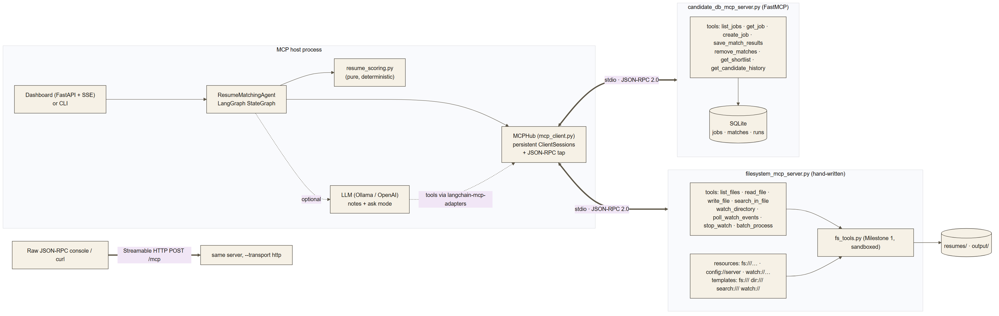
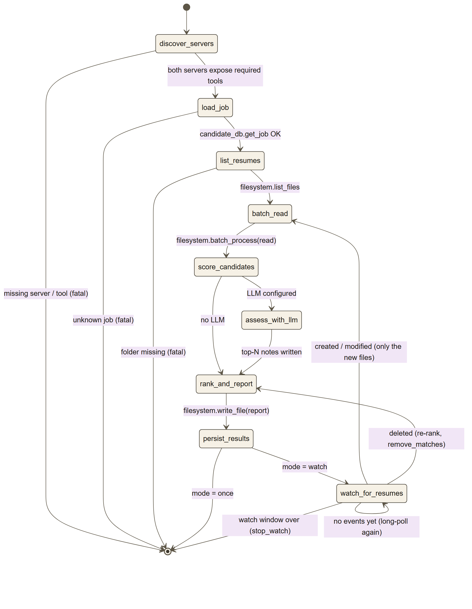
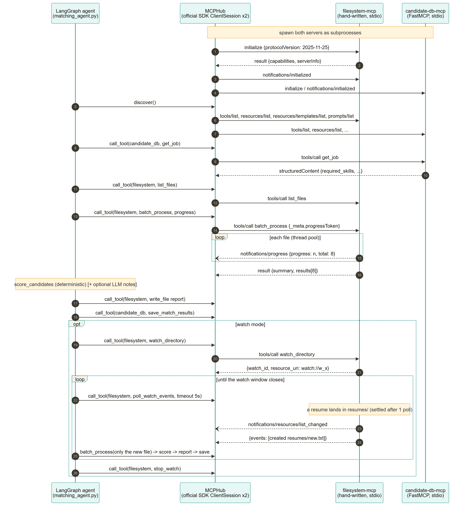

# Architecture: agent ↔ MCP interaction

## Components

Source: [`diagrams/architecture.mmd`](diagrams/architecture.mmd)

* The **host** (CLI or dashboard) owns one `MCPHub`. The hub spawns both servers as subprocesses and keeps one `ClientSession` open to each for its whole lifetime.
* The **agent** is a LangGraph `StateGraph`. Each node does at most a few MCP calls through the hub and returns a partial state update.
* The **filesystem server** wraps the unchanged Milestone 1 `fs_tools.py`. The sandbox, text extraction and error envelopes all come from there.
* The **candidate-db server** is the multi-MCP bonus. It is built on FastMCP, so the agent shows one client working against two very different server implementations.

## State machine

Source: [`diagrams/state_machine.mmd`](diagrams/state_machine.mmd). The graph exactly as LangGraph compiles it (`python matching_agent.py --diagram`): [`diagrams/langgraph_generated.mmd`](diagrams/langgraph_generated.mmd).

| Node | MCP calls | Next |
|---|---|---|
| `discover_servers` | `tools/list`, `resources/list`, `resources/templates/list`, `prompts/list` on both servers | `load_job`, or END if a required tool is missing |
| `load_job` | `candidate_db.get_job` (or parse `--job-text` locally) | `list_resumes`, or END on unknown job |
| `list_resumes` | `filesystem.list_files` | `batch_read` |
| `batch_read` | `filesystem.batch_process(read)` with a progress token | `score_candidates` |
| `score_candidates` | none (pure Python) | `assess_with_llm` if an LLM is set, else `rank_and_report` |
| `assess_with_llm` | none (LLM only) | `rank_and_report` |
| `rank_and_report` | `filesystem.write_file(output/match_<job>.md)` | `persist_results` |
| `persist_results` | `candidate_db.save_match_results`, `candidate_db.remove_matches` | END (once) or `watch_for_resumes` |
| `watch_for_resumes` | `filesystem.watch_directory` (first time), `poll_watch_events` (long-poll), `stop_watch` | `batch_read` (new/changed), `rank_and_report` (deleted), itself (nothing yet), END (window over) |

Errors: any `MCPToolError` is caught by the node wrapper and recorded in `state.errors`. Failures in `load_job` or `list_resumes` are fatal and route to END; failures elsewhere degrade gracefully (for example, a failed file in a batch is skipped and reported).

## Message sequence

Source: [`diagrams/sequence.mmd`](diagrams/sequence.mmd)

## Why these choices

| Decision | Reason |
|---|---|
| Hand-written filesystem server | The brief is to *implement* the protocol; doing it without the SDK makes framing, negotiation and error codes explicit and testable. Interop with the SDK client is proven by tests. |
| FastMCP for the second server | Shows the other common way to build a server, and that the client does not care. |
| Persistent sessions instead of `MultiServerMCPClient` defaults | Server-side state (`watch_directory`) must survive between tool calls. |
| `poll_watch_events` as well as push notifications | Pushes need a long-lived stream (stdio); polling works on every transport and is easy for an LLM to use. |
| Polling watcher with "settled" detection | Identical behaviour on every OS and on synced folders; never hands over half-copied files. |
| Deterministic scoring, LLM for notes only | Reproducible, testable rankings; the LLM is an optional explainer and can be offline. |
| Tool failures as `isError` results | Spec guidance (2025-11-25): models can read and fix them, while protocol errors are reserved for malformed requests. |
